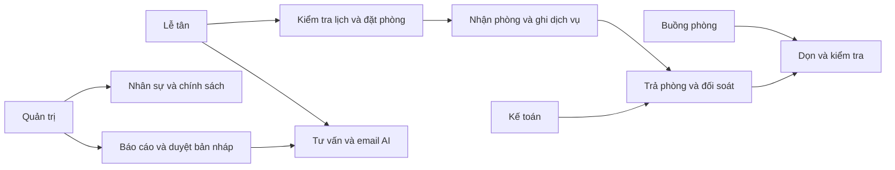
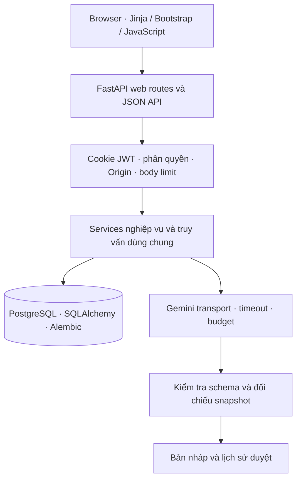
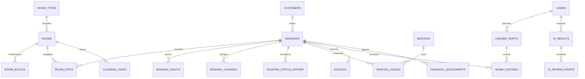

# Báo cáo kỹ thuật AIA331 · 80270

## 1. Bài toán và phạm vi

Lotus Hotel AI phục vụ khách sạn vừa và nhỏ: nhân viên tiếp nhận yêu cầu, kiểm tra lịch, tạo đặt phòng, nhận/trả phòng, ghi dịch vụ và thu tiền. Hệ thống có AI tư vấn phòng, soạn email và diễn giải công suất. Nhân viên xác nhận mọi thay đổi nghiệp vụ.

Phạm vi là quản lý nội bộ. Không có cổng khách tự đặt/thanh toán, OTA/channel manager, khóa cửa IoT hoặc hóa đơn điện tử. Quản trị viên tạo tài khoản nhân viên, kích hoạt và phân quyền; không có trang tự đăng ký công khai. Vai trò housekeeping bổ sung cho ba vai trò đề bài.

## 2. Actor và use case

| Actor | Nghiệp vụ |
|---|---|
| Quản trị | Nhân sự, cấu hình/chính sách, danh mục, mọi ca, báo cáo và duyệt AI |
| Lễ tân | Khách, lịch/phòng trống, booking/đổi lịch/đổi phòng, nhận/trả, dịch vụ, cọc và ca của mình; AI theo phạm vi |
| Kế toán | Bảng kê/thu/hoàn/điều chỉnh có lý do, chứng từ và đối soát, báo cáo và duyệt AI |
| Buồng phòng | Công việc dọn/kiểm tra phòng và trạng thái vật lý; không xem tài chính/giấy tờ khách |
| Gemini | Dịch vụ ngoài trả đề xuất/bản nháp, không có quyền ghi DB |

## 3. Kiến trúc và mã nguồn

Backend Python/FastAPI, giao diện HTML template hợp yêu cầu frontend của đề. `backend/api` và `backend/web` xử lý HTTP; `backend/services` giữ quy tắc; `backend/models` giữ ràng buộc; `core` giữ cấu hình, bảo mật, DB và giới hạn. Tài nguyên UI/font nằm cục bộ để giảm phụ thuộc lúc demo. Deployment dùng Docker non-root và PostgreSQL. SQLite giữ tương thích để phát triển/dự phòng local, không dùng làm lưu trữ Render.

## 4. Dữ liệu và tính nhất quán

ERD thể hiện quan hệ chính; [từ điển dữ liệu](data-dictionary.md) ghi đủ bảng/cột/FK/check/unique lấy từ metadata. Tiền dùng Decimal/Numeric, kiểm tra số tiền và công thức hóa đơn tại backend và DB. `MoneyEntry` là sổ giao dịch chuẩn; `Payment` cũ giữ tương thích, không cộng trùng. Số dư cũ chưa biết ngày được đánh dấu `legacy_opening`, không giả ngày thu/ca.

Khoảng lưu trú là `[ngày nhận, ngày trả)`: phòng trả ngày 17 có thể nhận lượt tiếp ngày 17. Tầng backend kiểm tra giao nhau cùng các chặng đổi phòng và block bảo trì. Khóa phòng/booking/ca và transaction bảo vệ các thao tác đồng thời; SQLite khóa ghi, PostgreSQL khóa hàng. Phòng sạch/sẵn sàng vật lý khác với phòng trống theo khoảng ngày.

Giá được chụp theo từng đêm, không thay hồi tố vì sửa bảng giá. Đổi lịch/phòng lưu lịch sử. Hủy/no-show áp dụng chính sách phí, ghi điều chỉnh; hoàn tiền trong phạm vi đã thu và có quyền/lý do. Request tài chính dùng khóa chống xử lý lặp; không xóa giao dịch cũ. Ca đóng giữ số liệu bàn giao và chênh lệch.

## 5. Quy trình sử dụng

1. Quản trị tạo/kích hoạt nhân viên, nhân viên đổi mật khẩu lần đầu.
2. Lễ tân chọn khoảng ngày, số khách, loại phòng; xem lịch và gợi ý Gemini từ phòng hợp lệ.
3. Chọn/tạo khách và tạo booking. Backend kiểm tra lại phòng, giá, sức chứa.
4. Mở ca để thu cọc, in phiếu. Khi khách đến xác nhận nhận phòng; ghi dịch vụ trong thời gian lưu trú.
5. Nếu cần, đổi lịch/phòng qua chức năng chuyên biệt để lưu giá/chặng và lịch sử.
6. Trả phòng, xem bảng kê từng đêm/dịch vụ/phụ thu/giảm giá/cọc; thu số còn lại, xuất PDF. Phòng chuyển sang cần dọn.
7. Buồng phòng hoàn thành dọn và kiểm tra; kế toán đối soát, chốt ca, xem báo cáo theo ngày.
8. AI tạo email/báo cáo dạng nháp; người có quyền kiểm tra, duyệt/sao chép/in.

Ảnh minh chứng thật trên CSDL QA giả: [lịch desktop](images/browser-desktop.png), [màn hình mobile](images/browser-mobile.png), [đặt phòng qua giao diện](images/browser-created-booking.png). Hai PDF giả tại `output/pdf`. Chưa kiểm thử máy in/điện thoại vật lý.

## 6. Chức năng AI và tối ưu prompt

| Chức năng | Nguồn và kiểm soát | Phiên bản |
|---|---|---|
| Tư vấn phòng | Backend lọc ngày/khách/ngân sách/tiện ích/bảo trì; model trả ID theo schema; đối chiếu lại ID/giá, tối đa 3 | room-advice-v2 |
| Email xác nhận/hủy/đổi/nhắc tiền | Điều kiện theo trạng thái/công nợ; dữ liệu tối thiểu; kiểm tra lại snapshot sau gọi; bản nháp có duyệt | booking-email-v2 |
| Báo cáo công suất | Snapshot báo cáo C17; key/value phải khớp; code dựng con số; ý tưởng khuyến mại cần quản lý duyệt | operating-report-v2 |
| Bàn giao ca | Chỉ tổng số liệu và ca trong quyền; model chọn trọng tâm, không đọc ghi chú nhân sự/khách | handover-v1 |

Prompt hệ thống yêu cầu chỉ dùng dữ liệu cung cấp, ngắn gọn và lịch sự. Ngày, số tiền, phòng trống do code quyết định. Không gửi số giấy tờ, thông tin thanh toán/thẻ/tài khoản; email chỉ dùng tên đã lọc và thông tin booking tối thiểu. Lưu model, prompt version, source có chọn lọc và lịch sử duyệt; bản cũ dùng `legacy/unknown`.

Timeout, giới hạn context, tối đa hai yêu cầu AI đang chạy và 10 yêu cầu/phút/người trong một tiến trình. Không tự retry ghi nghiệp vụ. AI không tự đặt phòng, gửi email, thu tiền hoặc áp dụng khuyến mại. Email tự do vẫn có thể diễn đạt sai, cần người duyệt; việc duyệt không thay thế việc đối chiếu nghiệp vụ.

[Đánh giá gọi thật](ai-live-evaluation-2026-10-23.json) có bốn request bằng dữ liệu giả: gợi ý phòng, báo cáo, email đầu và email sau sửa lỗi. Lần email đầu phát hiện bộ lọc giấy tờ che nhầm booking code; đã sửa bảo vệ mã lấy từ DB và thêm regression test. Đây là mẫu nhỏ, không chứng minh độ chính xác thống kê của model.

## 7. Kiểm thử và hiệu năng

[Ma trận yêu cầu](traceability.md) liên kết module/test; [nghiệm thu C21](acceptance-c21.md) giữ kết quả ở thời điểm C21; kết quả phát hành ghi trong release-evidence.md. Kiểm thử gồm đặt trùng/biên ngày/đồng thời, đổi lịch/phòng, trả phòng, bảng kê, thu/hoàn lặp, ca, quyền, riêng tư và AI bịa dữ liệu. Migration kiểm tra cài mới/nâng/hạ và bảo toàn lịch sử trên hai CSDL. AI unit/integration dùng mock, bốn request thật được ghi riêng.

Benchmark local PostgreSQL: 30 phòng, 120 booking, 72 GET tuần tự đều 200, chậm nhất 68,21 ms trong mẫu. Không tính mạng Render, cold start hay tải đồng thời. [JSON số đo](benchmark-postgres-2026-10-23.json) ghi môi trường và phương pháp.

Backup/restore chạy thật trên hai DB QA mới: 21 booking/12 phòng, 3 hóa đơn tổng 4.800.000đ, đối chiếu sổ tiền và 23 sequence/revision 0022. Đích có bảng bị từ chối. [Bằng chứng](backup-restore-evidence.json) không chứa hồ sơ khách hay secret.

## 8. Bảo mật và triển khai

Mật khẩu băm bcrypt, JWT cookie HttpOnly/Secure khi production, phân quyền tại server, chống Origin khác và giới hạn body trước parser. Chỉ quản trị viên tạo tài khoản và đổi vai trò. Secret lấy từ môi trường/Render, không đưa API key vào frontend/Git. SQLAlchemy dùng tham số; Jinja escape và DOM Option.text giảm chèn HTML. Tài chính có audit và khóa, không lưu dữ liệu thẻ.

[Runbook triển khai](deployment.md) hướng dẫn Docker, env, health, backup/restore, chuyển đích và rollback tương thích schema. [R02](render-release.md) ghi thông tin thực tế sau triển khai. CSDL Free hết hạn 22/11/2026; cần backup/chuyển trước hạn, báo cáo dự kiến 30/10. Web Free có cold start và quota chung workspace.

## 9. Vai trò AI trong SDLC và phân công

[Nhật ký AI](ai-usage-log.md) ghi prompt, quyết định, sửa lỗi và kết quả theo từng commit. [Kế hoạch](ke-hoach-hoan-thien-2-nguoi.md) phân công tài khoản và Git Flow main/dev/feature. Đây là sản phẩm có hỗ trợ coding agent; author Git thể hiện phân công đã thống nhất, không chứng minh tự động rằng hai người đã trực tiếp viết hoặc review từng dòng. Review chéo và diễn tập của sinh viên phải thực hiện thật, không dựng lại lịch sử.

## 10. Giới hạn và hướng phát triển

Phù hợp demo quản lý một khách sạn, chưa có kiểm toán bảo mật độc lập, HA, sao lưu tự động có giám sát hay kiểm thử tải production. Thông báo/email hiện là bản nháp; thanh toán ghi nhận thủ công, chứng từ nội bộ không thay hóa đơn điện tử. Công suất theo lịch, công nợ là hiện tại; báo cáo cần đọc đúng mốc dữ liệu. Hướng tiếp theo: gửi email qua hàng đợi có duyệt, phân tách cơ sở lưu trú, lịch sử giá nâng cao và theo dõi backup. Tiêu chí thuyết trình/trả lời câu hỏi cần hai thành viên tự chuẩn bị và diễn tập.
